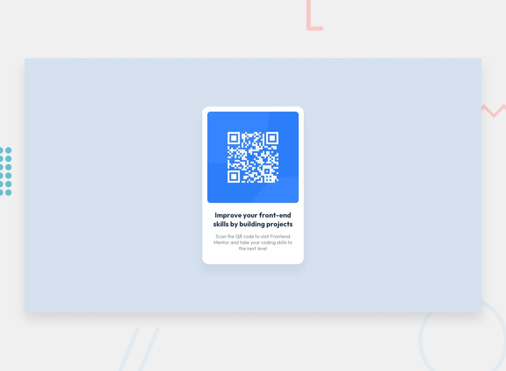

# QR Code Component

Mi primer proyecto de práctica realizado con Frontend Mentor.

## Descripción

Este proyecto consiste en una tarjeta que contiene un código QR para acceder a Frontend Mentor. El objetivo fue reproducir el diseño original utilizando HTML y CSS.

## Vista previa

## Tecnologías utilizadas

- HTML5
- CSS3
- Flexbox
- Git
- GitHub

## Proyecto publicado

[Ver sitio web](https://adriana135-tech.github.io/qr-code-component-main/)

## Repositorio

[Ver código fuente](https://github.com/adriana135-tech/qr-code-component-main)

## Lo que aprendí

- Estructurar una página con HTML.
- Aplicar estilos utilizando CSS.
- Organizar elementos con Flexbox.
- Utilizar Git y GitHub.
- Publicar mi proyecto con GitHub Pages.

## Autora

Adri

